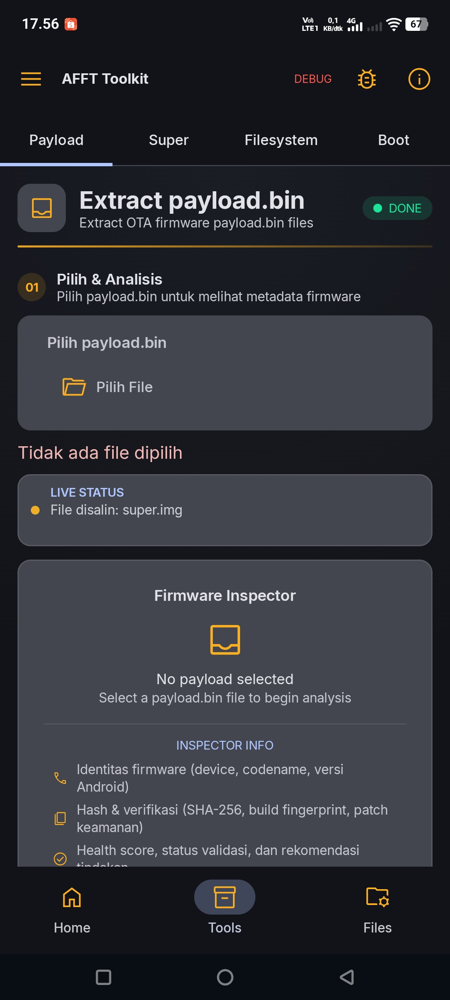
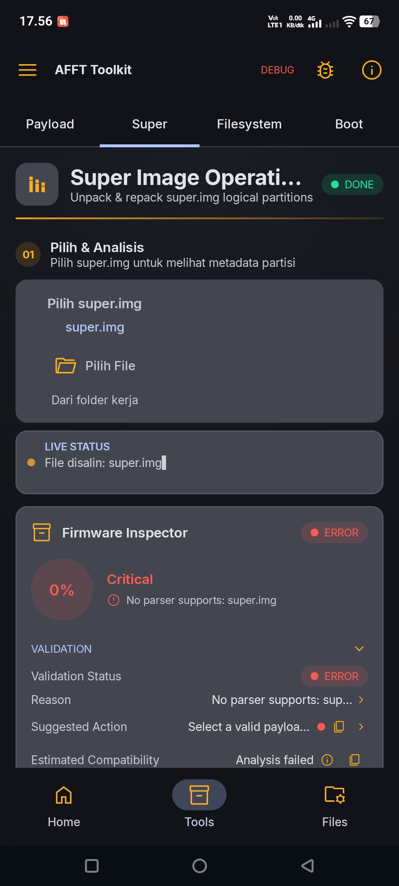
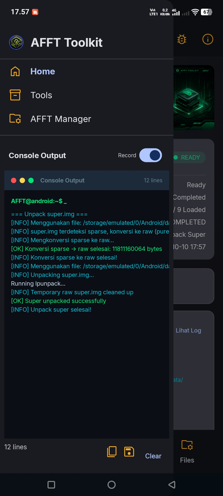

<div align="center">


# `AFFT TOOLKIT`

### `ANDROID FIRMWARE FULL TOOLKIT`

**Your Android. Your Firmware. Your Control.**

A native Android toolkit for analyzing, unpacking, modifying, and repacking Android firmware — directly on your device.

> **Data-loss warning:** Existing builds can follow filesystem symlinks while
> deleting extracted folders, potentially deleting files outside the workspace.
> Stop using AFFT, force-stop it, and revoke its all-files access until a fix
> has been independently validated. Do not retry extraction or cleaning.

<br>

<a href="https://github.com/soe1hom-arch/AFFT-Toolkit/releases/latest">
  
</a>
<a href="https://github.com/soe1hom-arch/AFFT-Toolkit/releases">
  
</a>


<br><br>

[ **DOWNLOAD APK** ](https://github.com/soe1hom-arch/AFFT-Toolkit/releases/latest)
&nbsp; · &nbsp;
[ EXPLORE SOURCE ](https://github.com/soe1hom-arch/AFFT-Toolkit)
&nbsp; · &nbsp;
[ REPORT AN ISSUE ](https://github.com/soe1hom-arch/AFFT-Toolkit/issues)

</div>

---

<div align="center">

**FIRMWARE WORKFLOW — WITHOUT A DESKTOP**

Inspect &nbsp; / &nbsp; Extract &nbsp; / &nbsp; Modify &nbsp; / &nbsp; Repack

</div>

## `BUILT FOR FIRMWARE WORK`

AFFT Toolkit brings essential Android firmware operations into one dedicated Android application. Work with supported firmware images, inspect partition structures, manage extracted files, and monitor operations through a unified interface.

No need to turn every firmware task into a separate workflow across multiple apps.

> **One toolkit. Multiple firmware workflows.**

## `CAPABILITIES`

<table>
<tr>
<td width="50%" valign="top">

### 🖥 `Payload Processing`

Analyze and unpack supported `payload.bin` firmware packages.

- Payload inspection
- Extraction workflow
- Firmware metadata

Each extraction uses a new directory under `temp/Payload`; previous results
are not removed. The output path is shown in the operation history and logs.
Incremental/delta payloads are not supported by the bundled dumper.

</td>
<td width="50%" valign="top">

### 💻 `Super Image Explorer`

Inspect supported Android dynamic partition images.

- Super image analysis
- Partition information
- Image structure inspection

</td>
</tr>
<tr>
<td width="50%" valign="top">

### 🔧 `Filesystem Tools`

Work with supported filesystem images and their metadata.

- Filesystem inspection
- Image analysis
- Extraction support where available

</td>
<td width="50%" valign="top">

### 💿 `Boot Image Tools`

Analyze supported boot-related images.

- Boot image inspection
- Metadata analysis
- Image workflow support

</td>
</tr>
<tr>
<td width="50%" valign="top">

### 💽 `Firmware Inspector`

Review firmware information and validation results.

- Device and build metadata
- Hashes and identifiers
- Validation feedback

</td>
<td width="50%" valign="top">

### 🛠 `Repack & Export`

Repack supported workflows and access generated output.

- Repacking operations
- Output to `Download/AFFT`
- File management through AFFT Manager

Exports are copies; they never delete or replace the source. Before export,
AFFT checks free space and whether `Download/AFFT` can preserve the required
file timestamps, POSIX permissions, and symbolic links. Filesystem exports
include the internal `fs_config` metadata and are rejected if that metadata is
incomplete. Unsupported files or metadata abort the export, and any staged
partial copy is removed. Use the internal workspace as the source for repack;
an exported copy is not validated for flashing. AFFT Manager can browse and
manage the internal filesystem workspace directly. Move operations are limited
to internal workspace folders; public storage is available through Export.

AFFT Manager can also open and edit UTF-8 text files (up to 1 MiB) in that
internal filesystem workspace, including `build.prop`, scripts and XML. Tap a
file or select **Edit teks**. Saving checks for external changes and uses an
atomic replacement, retaining UTF-8 BOM, line endings and verified POSIX
permissions, owner and group. Symbolic links, hard-linked files, binary data and
files outside this workspace cannot be edited. This is not an APK or binary
editor; preservation of all firmware security labels and metadata is not
guaranteed, and a repacked image should not be assumed safe to flash.

Every filesystem extraction uses a new workspace folder, including repeated
extractions of the same image, so earlier edits and their metadata are not
replaced. Failed extractions are marked incomplete and cannot be repacked;
EROFS extraction currently cannot capture equivalent `fs_config` metadata, so
the filesystem workspace export is rejected while that metadata is unavailable.

Filesystem repack produces **diagnostic images only — do not flash**. The app
warns when `fs_config` no longer matches the workspace or `file_contexts` is
missing. It cannot verify all SELinux labels or xattrs, and does not preserve,
sign, or verify AVB/vbmeta for the new image. The repacked filesystem format
may also differ from the original. Existing repack outputs are not overwritten;
if copying to Downloads fails, the diagnostic image remains in the workspace.

For an unlocked bootloader, Boot Tools offers an opt-in copy of a standalone
top-level vbmeta image with the AVB verification and hashtree disable flags set.
It preserves the original and never flashes either image. Signed inputs are
checked against their embedded key, but that key is not checked against the
device's trusted key; unsigned inputs cannot be authenticated. Changing the
flags invalidates existing signatures when the flags differ. The app cannot
determine bootloader state, device compatibility, rollback indices, or chained
vbmeta requirements. Flag changes are not guaranteed to work on every device
and disable important protections. Filesystem security metadata remains
unverified; these copies are not established as safe to flash.

</td>
</tr>
</table>

### `MORE THAN A COLLECTION OF TOOLS`

- **Workspace Projects** — organize firmware work in a dedicated workspace.
- **AFFT Manager** — manage files and generated output.
- **Console Output** — follow operation logs and diagnostic messages.
- **Live Status** — monitor task states and engine status.
- **Interactive Metadata** — inspect long values and detailed information.
- **Unified Navigation** — access the main toolkit modules from one interface.

> Feature availability depends on the selected image format, supported workflow, and device environment.

---

## `INSIDE AFFT TOOLKIT`

<div align="center">

### THE INTERFACE

Explore the application and its firmware workflows.

</div>

<table>
<tr>
<td align="center" width="50%">


**HOME**

</td>
<td align="center" width="50%">



**PAYLOAD TOOLS**

</td>
</tr>
<tr>
<td align="center" width="50%">



**SUPER IMAGE EXPLORER**

</td>
<td align="center" width="50%">


**BOOT TOOLS**

</td>
</tr>
<tr>
<td align="center" width="50%">


**FILESYSTEM INSPECTOR**

</td>
<td align="center" width="50%">


**FILE MANAGER**

</td>
</tr>
</table>

<div align="center">



**CONSOLE OUTPUT**

</div>

---

## `GET STARTED`

<div align="center">

### READY TO WORK WITH YOUR FIRMWARE?

Download the latest available APK from the official GitHub Releases page.

<br>

<a href="https://github.com/soe1hom-arch/AFFT-Toolkit/releases/latest">
  
</a>

</div>

### `REQUIREMENTS`

| Component | Requirement |
|:--|:--|
| Operating system | Android 8.0 (API 26) or later |
| Architecture | ARM64 / AArch64 |
| RAM | 4 GB minimum; 6 GB or more recommended |
| Storage | 10 GB or more recommended for firmware operations |

Actual resource requirements depend on the firmware image size and the operation being performed.

### `INSTALLATION`

1. Open the [latest release](https://github.com/soe1hom-arch/AFFT-Toolkit/releases/latest).
2. Download the APK asset provided by the release.
3. Allow installation from the relevant source if Android requests permission.
4. Install and open AFFT Toolkit.
5. Review the workspace and available tools before processing firmware.

---

## `WORKSPACE`

AFFT Toolkit uses a dedicated application workspace:

```text
/storage/emulated/0/Android/data/com.afft.app/files/workspace/
```

Extracted filesystem contents and their `fs_config` metadata are stored in the
app's private internal files area under `afft_work/filesystem/`. AFFT Manager's
**Workspace** location opens this area directly; it does not require an
external file manager. Exporting the `contents` option creates a copy of the
complete `filesystem/` workspace under `Download/AFFT/`.

| Directory / Resource | Purpose |
|:--|:--|
| Workspace | Working area for supported firmware operations |
| Input | Source files used by the applicable workflow |
| Output | Generated files, depending on the operation |

Directory names and available resources may vary by version and workflow. Repacked output is copied to `Download/AFFT`; use AFFT Manager when you need to manage or move the resulting files.

---

## `IMPORTANT — READ BEFORE USE`

> [!CAUTION]
> **Firmware modification carries real risks.**
>
> AFFT Toolkit is provided on an **"AS IS" and "AS AVAILABLE"** basis, without warranties of any kind, to the extent permitted by applicable law.
>
> Firmware images, partition layouts, boot images, and other low-level components can damage a device or render it unbootable when handled incorrectly.
>
> By using this application, you acknowledge that firmware operations are performed at your own risk. The developer is not responsible for device bricking, bootloops, corrupted firmware, failed flashing, data loss, or other damage resulting from use or misuse of the application, to the extent permitted by applicable law.
>
> **Before proceeding:**
>
> - Back up important data and firmware partitions.
> - Verify the device model and firmware compatibility.
> - Keep a recoverable copy of the original image.
> - Understand the operation before modifying or flashing any image.
> - Do not assume that a successful repack guarantees a bootable image.
> - Boot repack does not verify image compatibility or signatures. `vbmeta.img`
>   output is not signed or verified for AVB 2.0; do not flash it as-is.
>
> AFFT Toolkit does not guarantee compatibility with every device, image format, firmware package, or Android version.

---

## `PRIVACY & BACKUP`

AFFT Toolkit is designed for local firmware workflows on the Android device.

- Firmware processing uses local device resources.
- Generated files may contain sensitive device or firmware information.
- Keep backups in a secure location.
- Android backup behavior may exclude application data or files; do not rely on device backup alone to preserve your workspace.

Refer to the application's current privacy policy and repository documentation for the applicable details.

## `Credits`

AFFT Toolkit uses or incorporates third-party tools and libraries for firmware processing and application presentation.

| Component | Source |
|---|---|
| **payload-dumper-go** | [ssut/payload-dumper-go (Apache-2.0)](https://github.com/ssut/payload-dumper-go/tree/a51234eaead276ff3d8b8c4c439c51c7f46a96a8) |
| **lpmake / lpunpack** | [AOSP liblp](https://android.googlesource.com/platform/system/core/) |
| **magiskboot** | [topjohnwu/Magisk](https://github.com/topjohnwu/Magisk) |
| **simg2img** | [AOSP](https://android.googlesource.com/platform/system/core/) |
| **mkfs.erofs / extract.erofs** | [EROFS Tools source](https://github.com/sekaiacg/erofs-tools/tree/4f5d6efc225cf90064a8196b1412692fb89e1e69), built with a documented patch in CI |
| **debugfs** | [e2fsprogs v1.47.0](https://github.com/tytso/e2fsprogs/tree/25ad8a431331b4d1d444a70b6079456cc612ac40), built from pinned source in CI |
| **make_ext4fs** | Identical to [rendiix/make_ext4fs](https://github.com/rendiix/make_ext4fs/tree/4b805b4ff0129fb8df553247c1edce2fecfada6e); exact build source unverified |
| **liblzma / libzstd** | [XZ 5.4.6](https://github.com/tukaani-project/xz/tree/v5.4.6) / [Zstandard 1.5.5](https://github.com/facebook/zstd/tree/v1.5.5) |
| **Inter** | [rsms/inter](https://github.com/rsms/inter) — OFL-1.1 |
| **JetBrains Mono** | [JetBrainsMono](https://github.com/JetBrains/JetBrainsMono) — OFL-1.1 |

Third-party components, binaries, and assets remain subject to their respective licenses.

---

## `OPEN SOURCE & ATTRIBUTION`

AFFT Toolkit builds on the Android development ecosystem and may incorporate third-party tools or libraries.

Third-party components remain subject to their respective licenses and attribution requirements. See [`THIRD_PARTY_NOTICES.md`](THIRD_PARTY_NOTICES.md) for known sources and unresolved binary provenance.

## `DEVELOPER`

<div align="center">


`LuckyMan`

[GitHub Profile](https://github.com/soe1hom-arch)

</div>

## `LICENSE`

AFFT Toolkit is distributed under the **Apache License 2.0**.

See [`LICENSE`](LICENSE) for the complete license text and [`NOTICE`](NOTICE) for applicable notices.

---

<div align="center">

### `AFFT TOOLKIT`

**Analyze. Unpack. Modify. Repack.**

Built for Android firmware workflows.

[ DOWNLOAD LATEST RELEASE ](https://github.com/soe1hom-arch/AFFT-Toolkit/releases/latest)

<sub>Open source · Android native · Built for firmware work</sub>

</div>
