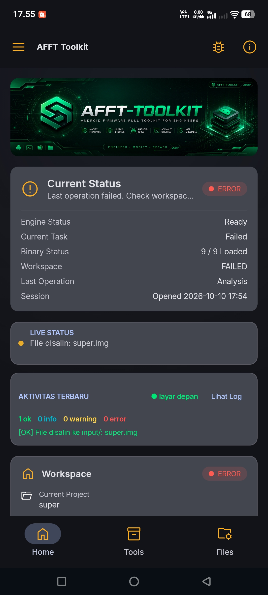
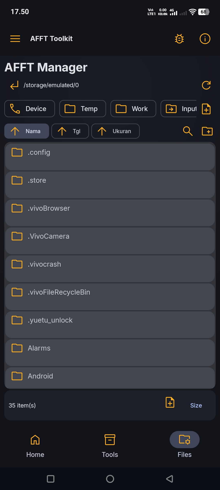
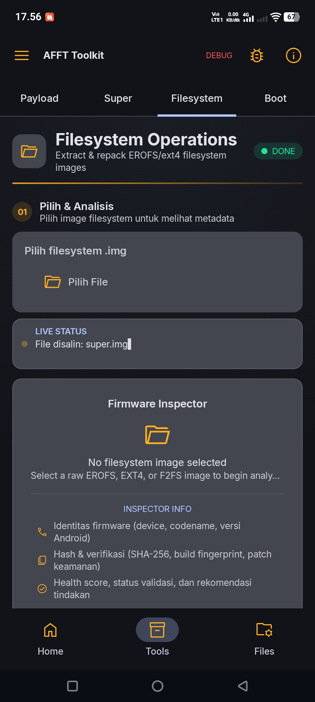
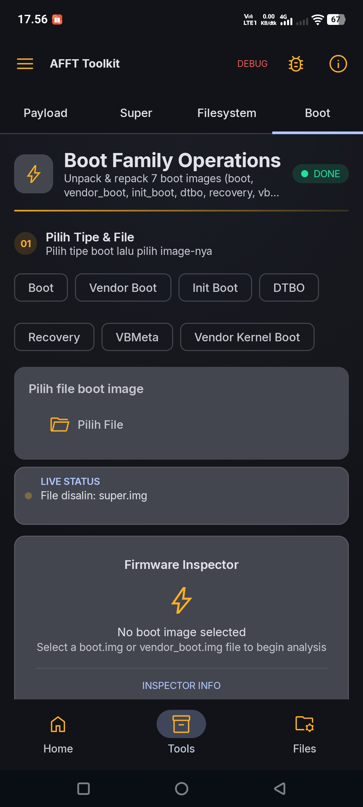

# AFFT Toolkit

**Android firmware tools, together in one app.**

Inspect images, extract supported firmware, and manage your workspace directly
on your Android device.

[Releases](https://github.com/soe1hom-arch/AFFT-Toolkit/releases) ·
[Test builds](https://github.com/soe1hom-arch/AFFT-Toolkit/actions/workflows/build.yml) ·
[Changelog](CHANGELOG.md) ·
[Report an issue](https://github.com/soe1hom-arch/AFFT-Toolkit/issues)

> [!IMPORTANT]
> The latest published release, **v2.3.0**, does not include the updates
> described on this page. A debug APK from GitHub Actions is a test build, not
> a new public release. Artifacts may require a GitHub login and can expire.

> [!CAUTION]
> The released v2.3.0 APK can follow filesystem symlinks while deleting
> extracted folders, potentially deleting files outside the workspace. Stop
> using it, force-stop it, and revoke its all-files access. The source fix has
> not yet been independently validated on Android. Avoid testing extraction
> or cleanup with important data.

## What you can do

| Tool | Purpose |
|:--|:--|
| **Payload** | Inspect and extract supported `payload.bin` packages. Incremental/delta payloads are not supported. |
| **Super** | Inspect and work with supported Android dynamic partition images. |
| **Filesystem** | Inspect and extract supported filesystem images, then create diagnostic repacks. |
| **Boot** | Inspect supported boot-family images and work with an optional diagnostic vbmeta copy. |
| **AFFT Manager** | Browse the internal filesystem workspace, manage files, and edit supported text files. |
| **Workspace and logs** | Organize projects, review operation history, and follow progress and logs. |

Availability depends on the image format, the bundled tools, and the device.

## Filesystem workspace

Extracted filesystem contents and their `fs_config` metadata are kept in the
app's private internal storage under `afft_work/filesystem/`. Open **Workspace**
in AFFT Manager to work with them without an external file manager. Each
filesystem extraction uses a new folder, so repeated extractions do not replace
earlier edits.

AFFT Manager can edit UTF-8 files up to 1 MiB, including `build.prop`, scripts,
XML and configuration files. Saving checks for conflicting changes and uses
an atomic replacement. Symbolic links, hard-linked files, binary files and
files outside the internal filesystem workspace cannot be edited this way.

Exports to `Download/AFFT` are copies. AFFT checks available space and the
destination's ability to preserve required timestamps, POSIX permissions and
symbolic links. Unsupported metadata or incomplete filesystem metadata stops
the export; the source remains in the workspace. EROFS extraction does not
currently capture equivalent `fs_config` metadata, so a filesystem workspace
containing such an extraction cannot be exported through this mechanism.

Uninstalling the app deletes its private workspace. Keep a separate backup
before uninstalling or changing installations.

## Repack and AVB safety

> [!WARNING]
> **Filesystem repacks and modified vbmeta copies are diagnostic outputs,
> not verified flash-ready images. Do not flash them.**

Filesystem repack warns when `fs_config` does not match the folder or
`file_contexts` is missing. Complete preservation and verification of
SELinux labels, xattrs, capabilities and hardlinks are not available. The
output filesystem format can differ from the original, and AVB metadata is
not preserved, signed or verified for the new image.

For devices with an unlocked bootloader, Boot Tools can optionally create a
separate standalone top-level vbmeta copy with verification and hashtree flags
disabled. The original is retained and AFFT does not flash either file. A
signed input is checked against its embedded key, not the device's trusted
key; unsigned input cannot be authenticated. Changing flags can invalidate
the signature and disables important protections. AFFT cannot establish
bootloader state, device compatibility, rollback requirements or the full AVB
chain. An unlocked bootloader does not guarantee that an image will boot.

Keep original images and backups, verify device-specific requirements, and
maintain a tested recovery path. Firmware modification can cause boot failure
or data loss. These workflows still need validation on real Android devices.

## Getting a test build

Test APKs, when available, are provided as `app-debug-apk` artifacts on the
[GitHub Actions build page](https://github.com/soe1hom-arch/AFFT-Toolkit/actions/workflows/build.yml).
Open a successful run for the desired commit and download its artifact.

A debug APK may be signed with a different key from the released APK and may
not install over it. **Back up your data before uninstalling:** removing the
existing app also removes its private workspace. Never rely on Android backup
alone to preserve firmware work.

| Requirement | |
|:--|:--|
| Android | 8.0 (API 26) or later |
| Architecture | ARM64 / AArch64 |
| Memory | 4 GB minimum; 6 GB or more recommended |
| Storage | 10 GB or more recommended, depending on image size |

## Screenshots

 

## Privacy and backups

Firmware processing uses local device resources. Firmware images and generated
files can contain sensitive information, so keep backups in a secure place.
Android backup may exclude application data and files.

## Credits and licenses

AFFT Toolkit uses third-party tools and libraries, including
[payload-dumper-go](https://github.com/ssut/payload-dumper-go/tree/a51234eaead276ff3d8b8c4c439c51c7f46a96a8),
[AOSP liblp](https://android.googlesource.com/platform/system/core/),
[Magisk](https://github.com/topjohnwu/Magisk),
[EROFS Tools](https://github.com/sekaiacg/erofs-tools/tree/4f5d6efc225cf90064a8196b1412692fb89e1e69),
[e2fsprogs](https://github.com/tytso/e2fsprogs/tree/25ad8a431331b4d1d444a70b6079456cc612ac40),
[XZ](https://github.com/tukaani-project/xz/tree/v5.4.6),
[Zstandard](https://github.com/facebook/zstd/tree/v1.5.5),
[Inter](https://github.com/rsms/inter), and
[JetBrains Mono](https://github.com/JetBrains/JetBrainsMono).
See [THIRD_PARTY_NOTICES.md](THIRD_PARTY_NOTICES.md) for licenses, source
details and unresolved binary provenance.

AFFT Toolkit is available under the [Apache License 2.0](LICENSE); see
[NOTICE](NOTICE) for applicable notices.
