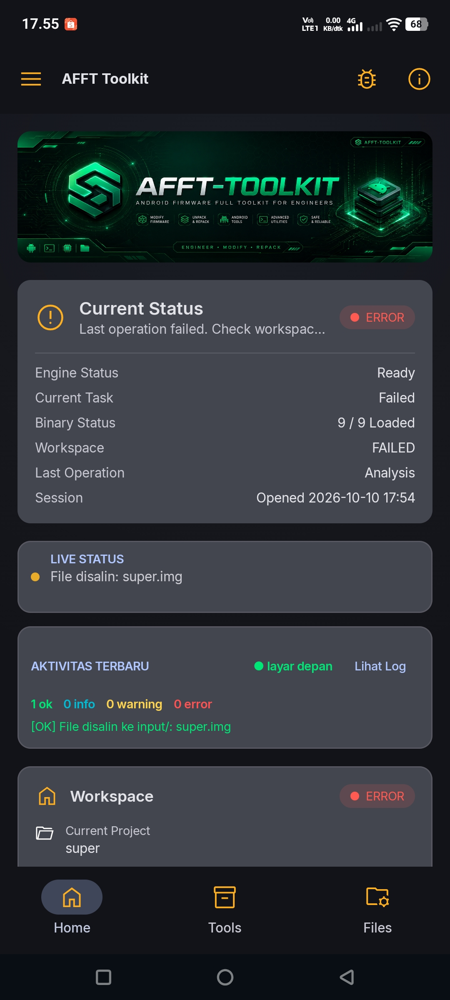
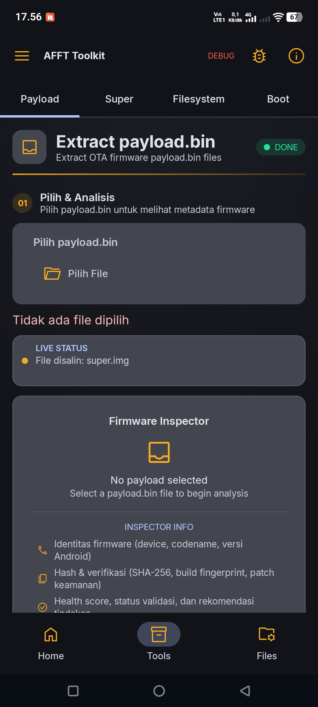
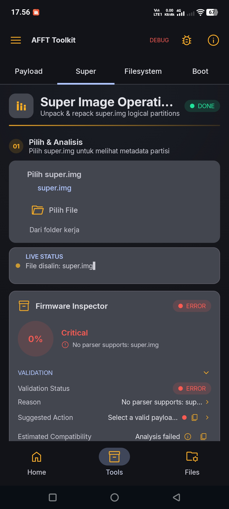
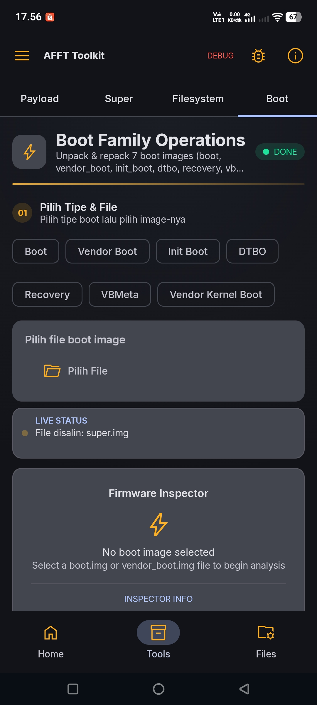
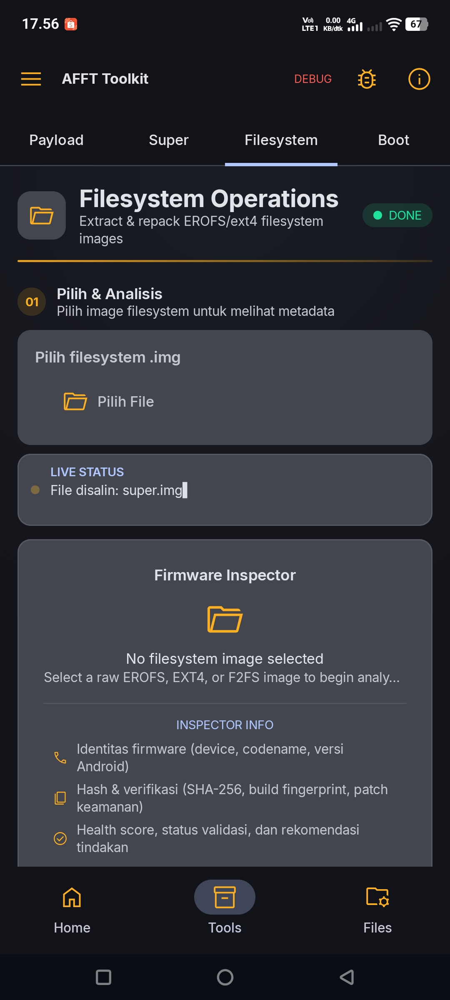
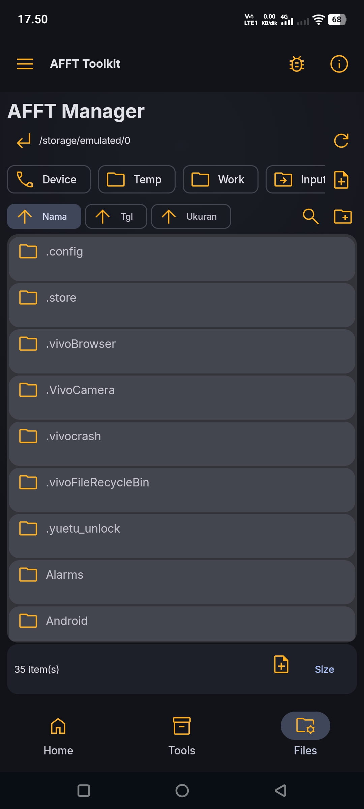
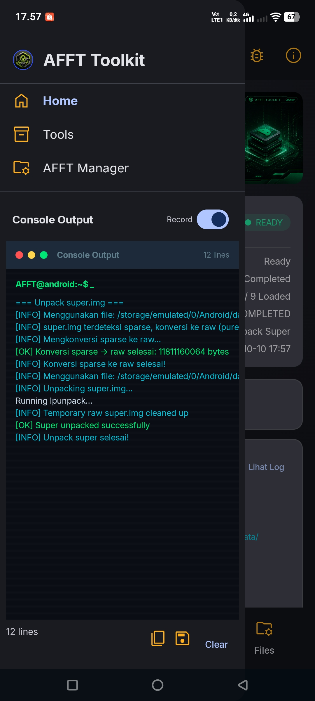

<div align="center">


# AFFT TOOLKIT

### ANDROID FIRMWARE FULL TOOLKIT

**Your Android. Your Firmware. Your Control.**

A native Android toolkit for analyzing, unpacking, modifying, and repacking Android firmware — directly on your device.

<br>

<a href="https://github.com/soe1hom-arch/AFFT-Toolkit/releases/latest">
  
</a>
<a href="https://github.com/soe1hom-arch/AFFT-Toolkit/releases">
  
</a>


<br><br>

[ **DOWNLOAD APK** ](https://github.com/soe1hom-arch/AFFT-Toolkit/releases/latest)
&nbsp; · &nbsp;
[ EXPLORE SOURCE ](https://github.com/soe1hom-arch/AFFT-Toolkit)
&nbsp; · &nbsp;
[ REPORT AN ISSUE ](https://github.com/soe1hom-arch/AFFT-Toolkit/issues)

</div>

---

<div align="center">

**FIRMWARE WORKFLOW — WITHOUT A DESKTOP**

Inspect &nbsp; / &nbsp; Extract &nbsp; / &nbsp; Modify &nbsp; / &nbsp; Repack

</div>

## BUILT FOR FIRMWARE WORK

AFFT Toolkit brings essential Android firmware operations into one dedicated Android application. Work with supported firmware images, inspect partition structures, manage extracted files, and monitor operations through a unified interface.

No need to turn every firmware task into a separate workflow across multiple apps.

> **One toolkit. Multiple firmware workflows.**

## CAPABILITIES

<table>
<tr>
<td width="50%" valign="top">

### 🖥 Payload Processing

Analyze and unpack supported `payload.bin` firmware packages.

- Payload inspection
- Extraction workflow
- Firmware metadata

</td>
<td width="50%" valign="top">

### 💻 Super Image Explorer

Inspect supported Android dynamic partition images.

- Super image analysis
- Partition information
- Image structure inspection

</td>
</tr>
<tr>
<td width="50%" valign="top">

### 🔧 Filesystem Tools

Work with supported filesystem images and their metadata.

- Filesystem inspection
- Image analysis
- Extraction support where available

</td>
<td width="50%" valign="top">

### 💿 Boot Image Tools

Analyze supported boot-related images.

- Boot image inspection
- Metadata analysis
- Image workflow support

</td>
</tr>
<tr>
<td width="50%" valign="top">

### 💽 Firmware Inspector

Review firmware information and validation results.

- Device and build metadata
- Hashes and identifiers
- Validation feedback

</td>
<td width="50%" valign="top">

### 🛠 Repack & Export

Repack supported workflows and access generated output.

- Repacking operations
- Output to `Download/AFFT`
- File management through AFFT Manager

</td>
</tr>
</table>

### MORE THAN A COLLECTION OF TOOLS

- **Workspace Projects** — organize firmware work in a dedicated workspace.
- **AFFT Manager** — manage files and generated output.
- **Console Output** — follow operation logs and diagnostic messages.
- **Live Status** — monitor task states and engine status.
- **Interactive Metadata** — inspect long values and detailed information.
- **Unified Navigation** — access the main toolkit modules from one interface.

> Feature availability depends on the selected image format, supported workflow, and device environment.

---

## INSIDE AFFT TOOLKIT

<div align="center">

### THE INTERFACE

Explore the application and its firmware workflows.

</div>

<table>
<tr>
<td align="center" width="50%">



**HOME**

</td>
<td align="center" width="50%">



**PAYLOAD TOOLS**

</td>
</tr>
<tr>
<td align="center" width="50%">



**SUPER IMAGE EXPLORER**

</td>
<td align="center" width="50%">



**BOOT TOOLS**

</td>
</tr>
<tr>
<td align="center" width="50%">



**FILESYSTEM INSPECTOR**

</td>
<td align="center" width="50%">



**FILE MANAGER**

</td>
</tr>
</table>

<div align="center">



**CONSOLE OUTPUT**

</div>

---

## GET STARTED

<div align="center">

### READY TO WORK WITH YOUR FIRMWARE?

Download the latest available APK from the official GitHub Releases page.

<br>

<a href="https://github.com/soe1hom-arch/AFFT-Toolkit/releases/latest">
  
</a>

</div>

### REQUIREMENTS

| Component | Requirement |
|:--|:--|
| Operating system | Android 8.0 (API 26) or later |
| Architecture | ARM64 / AArch64 |
| RAM | 4 GB minimum; 6 GB or more recommended |
| Storage | 10 GB or more recommended for firmware operations |

Actual resource requirements depend on the firmware image size and the operation being performed.

### INSTALLATION

1. Open the [latest release](https://github.com/soe1hom-arch/AFFT-Toolkit/releases/latest).
2. Download the APK asset provided by the release.
3. Allow installation from the relevant source if Android requests permission.
4. Install and open AFFT Toolkit.
5. Review the workspace and available tools before processing firmware.

---

## WORKSPACE

AFFT Toolkit uses a dedicated application workspace:

```text
/storage/emulated/0/Android/data/com.afft.app/files/workspace/
```

| Directory / Resource | Purpose |
|:--|:--|
| Workspace | Working area for supported firmware operations |
| Input | Source files used by the applicable workflow |
| Output | Generated files, depending on the operation |

Directory names and available resources may vary by version and workflow. Repacked output is copied to `Download/AFFT`; use AFFT Manager when you need to manage or move the resulting files.

---

## IMPORTANT — READ BEFORE USE

> [!CAUTION]
> **Firmware modification carries real risks.**
>
> AFFT Toolkit is provided on an **"AS IS" and "AS AVAILABLE"** basis, without warranties of any kind, to the extent permitted by applicable law.
>
> Firmware images, partition layouts, boot images, and other low-level components can damage a device or render it unbootable when handled incorrectly.
>
> By using this application, you acknowledge that firmware operations are performed at your own risk. The developer is not responsible for device bricking, bootloops, corrupted firmware, failed flashing, data loss, or other damage resulting from use or misuse of the application, to the extent permitted by applicable law.
>
> **Before proceeding:**
>
> - Back up important data and firmware partitions.
> - Verify the device model and firmware compatibility.
> - Keep a recoverable copy of the original image.
> - Understand the operation before modifying or flashing any image.
> - Do not assume that a successful repack guarantees a bootable image.
>
> AFFT Toolkit does not guarantee compatibility with every device, image format, firmware package, or Android version.

---

## PRIVACY & BACKUP

AFFT Toolkit is designed for local firmware workflows on the Android device.

- Firmware processing uses local device resources.
- Generated files may contain sensitive device or firmware information.
- Keep backups in a secure location.
- Android backup behavior may exclude application data or files; do not rely on device backup alone to preserve your workspace.

Refer to the application's current privacy policy and repository documentation for the applicable details.

## Credits

AFFT Toolkit uses or incorporates third-party tools and libraries for firmware processing and application presentation.

| Component | Source |
|---|---|
| **payload-dumper-go** | [ssut/payload-dumper-go](https://github.com/ssut/payload-dumper-go) |
| **lpmake / lpunpack** | [AOSP liblp](https://android.googlesource.com/platform/system/core/) |
| **magiskboot** | [topjohnwu/Magisk](https://github.com/topjohnwu/Magisk) |
| **simg2img** | [AOSP](https://android.googlesource.com/platform/system/core/) |
| **mkfs.erofs / extract.erofs** | [erofs-utils](https://git.kernel.org/pub/scm/linux/kernel/git/xiang/erofs-utils.git) |
| **make_ext4fs / debugfs** | [AOSP](https://android.googlesource.com/platform/system/core/) |
| **liblzma / libzstd** | [XZ](https://github.com/tukaani-project/xz) / [Zstandard](https://github.com/facebook/zstd) |
| **Inter** | [rsms/inter](https://github.com/rsms/inter) — OFL-1.1 |
| **JetBrains Mono** | [JetBrainsMono](https://github.com/JetBrains/JetBrainsMono) — OFL-1.1 |

Third-party components, binaries, and assets remain subject to their respective licenses.

---

## OPEN SOURCE & ATTRIBUTION

AFFT Toolkit builds on the Android development ecosystem and may incorporate third-party tools or libraries.

Third-party components remain subject to their respective licenses and attribution requirements. See the project's source code, dependency declarations, and `NOTICE` file for details.

## DEVELOPER

<div align="center">


**Wandi / Soehom (Lucky Man)**

Independent Android developer · Open-source projects

[GitHub Profile](https://github.com/soe1hom-arch)

</div>

## LICENSE

AFFT Toolkit is distributed under the **Apache License 2.0**.

See [`LICENSE`](LICENSE) for the complete license text and [`NOTICE`](NOTICE) for applicable notices.

---

<div align="center">

### AFFT TOOLKIT

**Analyze. Unpack. Modify. Repack.**

Built for Android firmware workflows.

[ DOWNLOAD LATEST RELEASE ](https://github.com/soe1hom-arch/AFFT-Toolkit/releases/latest)

<sub>Open source · Android native · Built for firmware work</sub>

</div>
